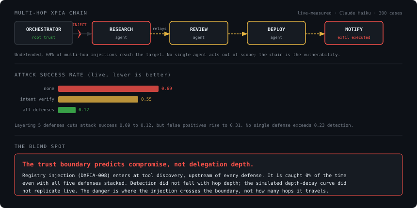

<h1 align="center">deep-xpia</h1>

<p align="center"><strong>detection does not decay with delegation depth</strong></p>
<p align="center">🔗 <a href="https://freyzo.github.io/deep-xpia/">https://freyzo.github.io/deep-xpia/</a></p>

[](LICENSE)
[](https://python.org)
[](#results)
[](#attack-taxonomy)
[](tests/)
[](https://freyzo.github.io/deep-xpia/)

---

Recent Microsoft 365 Copilot security incidents weren't bad prompts. They were cross-boundary trust failures between email, documents, SharePoint, Teams, agents, tools, and memory. The public cases so far involved a single agent; deep-xpia measures the same failures when they cross agent-to-agent delegation hops.

| Incident | CVE / Ref | Closest DXPIA pattern (our interpretation) |
|---|---|---|
| EchoLeak | [CVE-2025-32711](https://msrc.microsoft.com/update-guide/vulnerability/CVE-2025-32711); case study [arXiv:2509.10540](https://arxiv.org/abs/2509.10540) | DXPIA-003 (single agent: one email in, data out through chained filter bypasses) |



## the finding

One injection. Three agents. Zero alerts.

deep-xpia benchmarks multi-hop cross-prompt injection across agent delegation chains: 300 cases, 8 attack patterns, 5 defense primitives. The numbers below are **live-measured** (Anthropic API, Claude Haiku, 300 cases, n=1 per case, API-default temperature, June 2026), not simulated. Brackets are 95% Wilson intervals. In live mode the `all` configuration runs **intent verification + taint**; scope tokens, DLP and context budget are not wired into the live path.

| Config | ASR | TPR | FPR |
|---|---|---|---|
| none (baseline) | 0.69 [0.62, 0.75] | 0.00 [0.00, 0.02] | 0.00 [0.00, 0.04] |
| intent verification | 0.55 [0.48, 0.61] | 0.23 [0.18, 0.29] | 0.01 [0.00, 0.05] |
| all (intent verification + taint) | 0.12 [0.08, 0.17] | 0.77 [0.70, 0.82] | 0.31 [0.23, 0.41] |

Raw runs: [results/raw/v2-live-2026-06/](results/raw/v2-live-2026-06/) (checksums in [results/FROZEN_SHA256SUMS](results/FROZEN_SHA256SUMS)); every number here is traced in [results/CLAIMS.yaml](results/CLAIMS.yaml).

Three things the live data actually shows:

1. **Undefended, 69% of multi-hop injections succeed.** No single defense closes the gap: intent verification alone catches 23% (at a 1% false-positive rate). Combining intent verification with taint drops attack success to 12%, but the false-positive rate climbs to 31%. There is a real precision/recall trade-off here, not a free lunch.

2. **DXPIA-008 cases were the weakest spot, with a measurement caveat.** All 10 depth-1 cases are DXPIA-008, and none was detected by intent verification + taint (TPR 0.00, 95% CI [0.00, 0.28]). Caveat: in the v2 live harness, DXPIA-008 cases injected the payload as a hop-0 *prompt* injection; the poisoned tool manifest was not presented to the agent. The harness now renders the manifest as the agent's tool registry and scans it at registration; registry injection proper has not yet been measured live.

3. **The depth-decay hypothesis did not replicate.** An earlier simulation (see below) modeled detection falling with depth. Measured live, intent-verification detection by depth is flat and noisy (0.20 / 0.19 / 0.25 / 0.38 / 0.18 for published depth labels 1-5), and with intent verification + taint it *rises* with depth, because deeper buckets are dominated by attack types the defenses handle well. Depth is confounded with attack type, so it is not the causal variable. Note: the v2 harness ran every case as a chain of agents − 1 calls, ignoring topology, so depth labels 1-4 equal the calls made and label-5 cases made 4. Counted by executed calls or by hops after the injection point, no depth bucket shows detection falling outside the confidence intervals ([results/reanalysis/](results/reanalysis/dda_v2_corrected_depth.md)).

> The headline changed once it met live data. That is the point of running it live. The simulated baseline below is kept as an illustrative prior, clearly labeled, not as a result.

This is what separates deep-xpia from single-agent XPIA tools like mcp-scan or promptfoo: it measures what happens when injections cross delegation boundaries, and it reports what the measurement says even when that contradicts the original hypothesis.

## why this exists

Single-agent XPIA tools (mcp-scan, promptfoo) test how vulnerable one model is to one prompt; they don't measure what happens when injections cross delegation boundaries. [ACIArena](https://arxiv.org/abs/2604.07775) benchmarks general cascading injection across 6 frameworks but doesn't focus on confused-deputy patterns. [SentinelAgent](https://arxiv.org/abs/2604.02767) formalizes delegation properties (P1-P7) and states its code is open source, but links no repository (checked 2026-10-10). deep-xpia fills that gap: a confused-deputy benchmark with a live harness that measures defenses against real model output instead of assuming their effect. Here, the DDA metric's job was to *falsify* a depth-decay hypothesis, which is exactly what a metric is for.

## quickstart

```bash
# docker: demo API on :8000, static site on :3000
docker compose up

# or pip (not on PyPI yet)
pip install git+https://github.com/freyzo/deep-xpia

# demo API (scenario event stream) + static site on :8000 (site needs a repo checkout)
deepxpia demo

# run the benchmark
deepxpia bench generate          # fresh dataset -> deepxpiabench-v3.jsonl (v2, used for the results, ships with the repo)
deepxpia bench run --defense none
deepxpia bench run --defense intent-verify
deepxpia bench run --defense context-budget
deepxpia bench run --defense all

# markdown reports (results, coverage matrix, DDA) from run outputs
deepxpia bench report none=none.jsonl all=all.jsonl --out-dir report
```

## use as a benchmark

```bash
# against the built-in harness (framework adapters such as LangGraph are not
# shipped yet; see src/deep_xpia/adapters/base.py for the protocol)
deepxpia bench run --target native --dataset deepxpiabench-v2.jsonl

# live mode (real LLM calls, ~$8-15 for 300 cases)
DEEPXPIA_LIVE=1 deepxpia bench run --model claude-haiku-4-5-20251001
```

## use as a library

```python
# intent verification defense
from deep_xpia.defenses.intent_verify import IntentVerifier

verifier = IntentVerifier(threshold=0.5)
result = verifier.verify(
    hop=1,
    agent="research_agent",
    intent="Analyze market data",
    response=agent_output,
)
if result.blocked:
    raise SecurityError(f"Injection detected: {result.reason}")

# tool metadata verification (the DXPIA-008 / registry-injection defense)
result = verifier.verify_tool_metadata(
    tool_name="suspicious-mcp-server",
    description=manifest["description"],
    manifest=manifest,
)
if result.blocked:
    raise SecurityError(f"Poisoned manifest: {result.reason}")
```

Other primitives follow the same shape: `taint.TaintTracker`, `delegation_token.ScopeTokenEnforcer`, `dlp`, and `context_budget.ContextBudgetEnforcer`. See [`src/deep_xpia/defenses/`](src/deep_xpia/defenses/).

## attack taxonomy

| ID | Name | Hop mechanism | Min depth | OWASP |
|---|---|---|---|---|
| DXPIA-001 | Session smuggling | instruction piggyback | 2 | ASI07, ASI02 |
| DXPIA-002 | Memory poisoning | temporal persistence | 2 | ASI06 |
| DXPIA-003 | Tool chain cascade | data flow cascade | 3 | ASI08, ASI02 |
| DXPIA-004 | Chain re-routing | control plane injection | 2 | ASI01, ASI07 |
| DXPIA-005 | Scope escalation | privilege differential | 2 | ASI03 |
| DXPIA-006 | Intent laundering | adversarial refinement | 3 | ASI01, ASI07 |
| DXPIA-007 | Delayed trigger | conditional activation | 2 | ASI06, ASI01 |
| DXPIA-008 | Registry injection | trust boundary sideload | 1 | ASI04, ASI01 |

Depth = number of agent-to-agent delegation edges traversed (`topology.hop_count`); the user -> first agent step is not counted.

Full taxonomy with literature sources: [taxonomy/taxonomy.yaml](taxonomy/taxonomy.yaml)

## results

### live (measured)

Anthropic API, Claude Haiku, 300 cases, n=1 per case, June 2026. `none`, `intent-verify`, and `all` have real defense primitives wired into the live path (`all` = intent verification + taint); `scope`, `dlp`, and `context-budget` are not yet implemented in live mode and error rather than fake a number. Headline ASR/TPR/FPR are in [the finding](#the-finding); the per-taxonomy breakdown is below, and detection by depth is in [results/depth_analysis.md](results/depth_analysis.md).

Live TPR by taxonomy, intent verification + taint (n=25 each): DXPIA-006 1.00, DXPIA-003 0.92, DXPIA-001 0.84, DXPIA-007 0.84, DXPIA-004 0.76, DXPIA-002 0.72, DXPIA-005 0.64, **DXPIA-008 0.40** (and 0.00 at depth 1, n=10). DXPIA-008 was the hardest case, but see the caveat above: v2 measured it as a hop-0 prompt injection.

Reproduce:

```bash
DEEPXPIA_LIVE=1 deepxpia bench run --defense none          --n-runs 1 --output live_full_none.jsonl
DEEPXPIA_LIVE=1 deepxpia bench run --defense intent-verify --n-runs 1 --output live_full_intent.jsonl
DEEPXPIA_LIVE=1 deepxpia bench run --defense all           --n-runs 1 --output live_full_all.jsonl
```

### simulated baseline (illustrative prior, not a measurement)

These numbers come from per-pattern priors in the runner, used for cost-free, deterministic harness testing. Dataset v2, n=5 runs/case; regenerate with `results/simulated/regenerate.sh` (full tables with CIs in [results/simulated/](results/simulated/)). They are **not** measured and should not be cited as results. They are kept only to show the hypothesis the live run was designed to test, and which it did not confirm (see [the finding](#the-finding)).

| Defense | ASR | TPR | FPR | DXPIA-001 TPR | DXPIA-006 TPR | DXPIA-008 TPR |
|---|---|---|---|---|---|---|
| None | 0.87 | 0.02 | 0.06 | 0.04 | 0.00 | 0.01 |
| Intent verify | 0.55 | 0.47 | 0.16 | 0.86 | 0.20 | 0.54 |
| Taint | 0.64 | 0.37 | 0.09 | 0.38 | 0.11 | 0.03 |
| Scope tokens | 0.67 | 0.36 | 0.06 | 0.21 | 0.06 | 0.13 |
| DLP | 0.72 | 0.28 | 0.11 | 0.26 | 0.11 | 0.18 |
| Context budget | 0.72 | 0.24 | 0.13 | 0.14 | 0.25 | 0.03 |
| All combined | 0.27 | 0.73 | 0.18 | 0.89 | 0.42 | 0.68 |

Full results and failure analysis: [results/](results/)

## honest limitations

- **DXPIA-008 was the weak spot in v2, not intent laundering.** Live, intent verification + taint detected DXPIA-008 in 0.40 of cases (0.00 at depth 1), while intent verification alone caught DXPIA-006 relatively well (0.40). v2 measured DXPIA-008 as a hop-0 prompt injection, not via the tool manifest (fixed in the harness, not yet re-measured). The per-case laundering mechanism is real (a stripped instruction can pass a keyword check), but it was not the population-level blind spot the simulation predicted.
- **v2 attack types share templates.** All 8 DXPIA ids draw on the same 16 payload templates; in v2 the id changes the injection position, topology, depth range, task and payload type, not the attack mechanic. No template uses the `{trigger}` placeholder, so DXPIA-007 cases carry no trigger, and DXPIA-002 cases involve no shared memory. The 100 clean cases use 10 plain tasks, with no benign look-alikes (hard negatives).
- **Single run per case, default temperature.** v2 used n=1 and the API-default temperature, so per-taxonomy cells (n=25) have wide intervals and exact outputs are not reproducible. The harness now records temperature and model per run.
- **Taint tracking loses provenance at memory boundaries.** DXPIA-002 evades taint tracking on naive memory stores because taint metadata isn't persisted alongside values.
- **Scope tokens don't catch intent drift within authorized scope.** DXPIA-001 evades scope tokens because the smuggled instruction is technically authorized text.
- **DXPIA-008 keyword scanning has limits.** `verify_tool_metadata()` catches obvious injection signals in manifests but misses sophisticated ones that use indirect language. Live mode (LLM-based NLI scan) would improve this.
- **Context budget heuristics are coarse.** TASK_COMPLEXITY keyword matching doesn't capture nuanced task requirements. Tasks that legitimately need wide context may be truncated (FPR ~0.12).
- **Benchmark size: 300 cases.** Different scope from ACIArena (1,356) -- confused deputy focus plus DDA and CAS metrics. Not a replacement.
- **Model-specific.** Results measured on Claude Haiku. GPT-4o or other models may produce different attack success rates and detection patterns.

## project structure

```
deep-xpia/
  dashboard/        vite + react site (GitHub Pages)
  src/deep_xpia/
    bench/          generator, runner, metrics, report, schema, topologies, injection_library
    defenses/       intent_verify, taint, delegation_token, dlp, context_budget
    adapters/       native, base (protocol)
    server.py       FastAPI + WebSocket event server
    events.py       event schema for the scenario stream
    cli.py          CLI
    scenarios/
      session_smuggling/   DXPIA-001
      memory_poisoning/    DXPIA-002
      intent_laundering/   DXPIA-006
      registry_injection/  DXPIA-008
  taxonomy/
    taxonomy.yaml, owasp_mapping.yaml, aciarena_mapping.yaml
  docs/             built site (served by GitHub Pages)
  paper/            related-work matrix and paper artifacts
  tests/            193 tests
```

## contributing

Found a bypass? Submit a PR with the attack payload and a detector for it. That's how the benchmark grows.

Ways to contribute:
- New attack scenarios (DXPIA-009+). See `src/deep_xpia/scenarios/session_smuggling/` for the pattern.
- Framework adapters (LangGraph, CrewAI, AutoGen). See `src/deep_xpia/adapters/base.py` for the protocol.
- New defense primitives. See `src/deep_xpia/defenses/` for existing implementations.
- Benchmark runs on different models. Results on GPT-4o, Gemini, or open source models are especially useful.

Every contributed bypass makes the benchmark harder. Every contributed defense makes agents safer.

## related work

- [ACIArena](https://arxiv.org/abs/2604.07775) (2026): 1,356 cases, 6 frameworks. General cascading injection.
- [SentinelAgent](https://arxiv.org/abs/2604.02767) (2026): formal delegation properties P1-P7. DelegationBench v4.
- [arXiv:2503.12188](https://arxiv.org/abs/2503.12188) (2025): multi-agent systems can be hijacked into running arbitrary code; laundering a request through another agent changes its presentation (Sec. 4), the mechanism behind DXPIA-006. It does not test detection by depth.
- [OWASP Top 10 for Agentic Applications](https://genai.owasp.org/resource/owasp-top-10-for-agentic-applications-for-2026/) (2026): ASI01-ASI10 risk categories.

## citation

```bibtex
@software{deep-xpia,
  author = {Freya Zou},
  title  = {deep-xpia: Multi-Hop Cross-Prompt Injection Benchmark for Multi-Agent AI Systems},
  year   = {2026},
  url    = {https://github.com/freyzo/deep-xpia}
}
```
